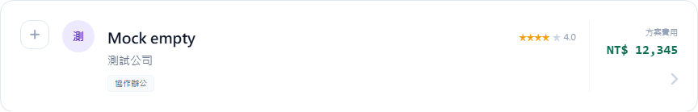

# SYNC 方案圖片 v1.1

## 動工前相容性檢查

2026-11-09 查核遠端 `main`，目前為規格指定的 `e6964eb9362011879373f2a6380516327c18cf43`，包含已合併的 PR #302。前版基準 `8851fc1` 可用於無圖卡片比對。

| 檢查項目 | 結果 |
| --- | --- |
| 列表文字圖 | v1 的 `card` 在無圖或主圖失敗時顯示文字圖。 |
| 詳情插入點 | v1 相框在費用與方案介紹之間。標題卡後、`ContactInfoCard` 前有可用插入點。 |
| 圖片來源 | v1 的主圖和背景圖同時使用同一個 `src`。 |
| 更新時間 | v1 migration 定義 `updated_at default now()`，遠端主分支未定義此更新 trigger。 |
| 桌機列表 | v1 的相框排在費用區的 chevron 之後。原費用區與箭頭可保留在無圖卡片的既有 DOM。 |

## 分支與交付

- 分支 `codex/solution-images-v1-1`，功能 commit `4be6b936aea6aeb0210ba63c18586a5d21e20343`。
- PR 已開啟，base 為 `main`，尚未合併。[PR #303](https://github.com/Pcc329/solution-finder/pull/303)
- Vercel Preview 部署成功。Preview 的 `/solution-image.js` 回 HTTP 200，含 `data-src` 及新的延遲載入 handler。[Preview](https://solution-finder-git-codex-sol-cbc0b0-patrick0814-6136s-projects.vercel.app)

| 檔案 | 行數 | 變更 |
| --- | --- | --- |
| `public/solution-image.js` | +15 / −34 | 移除文字圖及配色。主圖成功才設定背景 `src`，主圖失敗移除相框。兩個 handler 只執行一次。 |
| `public/index.html` | +14 / −11 | 移除文字圖樣式，調整桌機相框及箭頭順序，將詳情相框移到聯絡資訊前。 |
| `migrations/20261110_solution_images_updated_at.sql` | +21 | 新增交易包裹的 BEFORE UPDATE trigger 和 function 權限。 |
| `_handover/SYNC_solution_images_v1_1_2026-11-10.md` | +155 | 本驗收紀錄。 |
| `_handover/solution-images-v1-1-before.png`、`_handover/solution-images-v1-1-after.png` | PNG，各 10,204 bytes | 同一無圖 mock 卡片的前後截圖。 |
| `api/solutions.js`、`migrations/20261109_solution_images.sql`、`vercel.json` | 0 | 與本次基準 `e6964eb` 比對。 |

## 驗收紀錄

| 驗收 | 結果 |
| --- | --- |
| 無圖卡片與 `8851fc1` 一致 | 同一組 mock 下，無圖卡片的 `outerHTML` 完全相同，兩張 864×139 截圖逐位元組相同。 |
| 有圖、失效圖、非 HTTPS | 有圖顯示相框。失效圖的相框移除，外層佔寬為 0，無破圖。非 HTTPS 不產生相框。 |
| 桌機與手機 | 桌機先顯示內容及費用，再顯示 176×99 相框，箭頭最右。375px 手機版相框在內容上方，頁面可視寬及捲動寬都是 375px。 |
| 詳情 | 相框在標題卡與聯絡資訊之間，測得寬度 640px。無圖詳情沒有相框。 |
| 背景載入及錯誤處理 | 成功與失敗皆用本機 HTTPS mock。主圖完成前背景只有 `data-src`，主圖失敗時背景無請求。見下方 CDP 紀錄。 |
| 文字圖與腳本降級 | renderer 和 CSS 均已移除文字圖。模擬 `window.renderSolutionImage` 不存在時，列表、詳情仍正常渲染。 |
| migration | 本機 PGlite（PostgreSQL 18.6）執行 v1 及 v1.1 migration，`set note = note` 也會更新時間。RLS 和表格權限查詢前後一致。 |
| API diff | `git diff --exit-code e6964eb -- api/solutions.js` 通過，0 行。 |
| Node 回歸測試 | `node --check` 通過。頂層 11 個測試檔共 292 項通過。 |
| Preview 固定對照 | Preview `/api/solutions` 未登入回 HTTP 401。正式資料的 `SOL-0771`（Jubo）及 `SOL-MOE-0399` 待 PPC 登入後查驗。 |

### 同一無圖方案前後截圖

以 `SOL-MOE-0399` 為本機 mock ID，顯示虛構名稱與公司。兩張截圖 SHA-256 皆為 `a1014877e6bcdbc59576b72b58268a97c306a0edfa32e76893008fc199dd666f`。

**改版前 `8851fc1`**



**改版後 `4be6b93`**


### Chromium DevTools Network 紀錄

Chromium 148.0.7778.96，透過 DevTools Protocol 開啟 Network 並保留快取。轉址和圖檔回應皆為 `Cache-Control: public, max-age=600`。測試在圖檔回應前暫停，確認背景層無 `src`，再放行主圖。

| 情境 | 層 | 向本機 HTTP 伺服器發出請求 | 快取觀察 |
| --- | --- | --- | --- |
| 成功 | 主圖 | 1 次 `/mock-images/redirect`（302）及 1 次 `/mock-images/asset.svg`（200） | CDP 兩個回應的 `fromDiskCache` 皆為 false。 |
| 成功 | 背景 | 0 次新增請求 | 背景在設定 `src` 後成功解碼，無獨立 CDP 快取事件。觀察結果為重用瀏覽器已載入資源，無第二次網路傳輸。 |
| 失敗 | 主圖 | 1 次 `/mock-images/broken`（200，無法解碼） | `fromDiskCache` 為 false。 |
| 失敗 | 背景 | 0 次 | 未設定 `src`，隨相框移除。 |

CDP 事件順序如下。這是可快取的本機 mock 紀錄，正式圖片來源的快取策略未驗證。

```text
request  /mock-images/redirect
request  /mock-images/broken
redirect /mock-images/redirect   302  fromDiskCache=false
request  /mock-images/asset.svg
response /mock-images/broken     200  fromDiskCache=false
response /mock-images/asset.svg  200  fromDiskCache=false
```

### 本機 migration 結果

Windows 應用程式控制阻擋原生 PostgreSQL 16 的 PL/pgSQL／服務啟動。SQL 驗證在本機記憶體內的 PGlite（PostgreSQL 18.6）完成。空更新後的 `updated_at` 從 `2020-01-01 08:00:00+08` 變為 `2026-11-09 10:04:37.713+08`，等於該交易的 `now()`。

| role | v1 table grants | v1.1 table grants | trigger function EXECUTE |
| --- | --- | --- | --- |
| anon | SELECT | SELECT | false |
| authenticated | SELECT | SELECT | false |

### 上線交接

PPC 可先登入 Preview 驗收固定對照組。前端上線與新 migration 互不依賴。建議確認版面後由 PPC 合併，再在 Supabase SQL Editor 執行新 migration。正式資料庫未執行 v1.1 migration 或測試寫入。

## `public/solution-image.js` 完整 diff

```diff
diff --git a/public/solution-image.js b/public/solution-image.js
index 1917eec..fb4ec70 100644
--- a/public/solution-image.js
+++ b/public/solution-image.js
@@ -2,12 +1,0 @@
-  const palette = new Map([
-    ['銷售管理', ['#ede9fe', '#4c1d95']],
-    ['行銷推廣', ['#fce7f3', '#831843']],
-    ['生產物流', ['#fef3c7', '#78350f']],
-    ['協作辦公', ['#dbeafe', '#1e3a8a']],
-    ['人力資源', ['#ffe4e6', '#881337']],
-    ['資安合規', ['#e0e7ff', '#312e81']],
-    ['研發創新', ['#ccfbf1', '#134e4a']],
-    ['醫療照護', ['#dcfce7', '#14532d']],
-    ['暫無法分類', ['#f1f5f9', '#334155']],
-  ]);
-
@@ -32,6 +20,5 @@
-  function renderFallback(name, companyName, category) {
-    const firstCategory = String(category || '').split(',')[0].trim();
-    const [background, ink] = palette.get(firstCategory) || palette.get('暫無法分類');
-    return `<div class="solution-image-fallback" style="background:${background};color:${ink}">
-      <strong>${name}</strong><span>${escapeHtml(companyName)}</span>
-    </div>`;
+  function loadSolutionImageBackdrop(image) {
+    image.onload = image.onerror = null;
+    const backdrop = image.previousElementSibling;
+    backdrop.src = backdrop.dataset.src;
+    backdrop.removeAttribute('data-src');
@@ -41,5 +28,2 @@
-    image.onerror = null;
-    const frame = image.parentElement;
-    const fallback = frame.querySelector('template');
-    if (fallback) frame.replaceChildren(fallback.content);
-    else frame.remove();
+    image.onload = image.onerror = null;
+    image.parentElement.remove();
@@ -48,2 +32 @@
-  function renderSolutionImage({ imageUrl, solutionName, companyName, category, variant }) {
-    const detail = variant === 'detail';
+  function renderSolutionImage({ imageUrl, solutionName, variant }) {
@@ -51 +34 @@
-    if (detail && !url) return '';
+    if (!url) return '';
@@ -54,8 +37,5 @@
-    const fallback = detail ? '' : renderFallback(name, companyName, category);
-    if (!url) return `<div class="solution-image-frame">${fallback}</div>`;
-
-    const attrs = `src="${url}" loading="lazy" decoding="async" referrerpolicy="no-referrer"`;
-    return `<div class="solution-image-frame${detail ? ' solution-image-detail' : ''}">
-      
-      
-      ${detail ? '' : `<template>${fallback}</template>`}
+    const attrs = 'loading="lazy" decoding="async" referrerpolicy="no-referrer"';
+    return `<div class="solution-image-frame${variant === 'detail' ? ' solution-image-detail' : ''}">
+      
+      
@@ -65,0 +46 @@
+  window.loadSolutionImageBackdrop = loadSolutionImageBackdrop;
```
